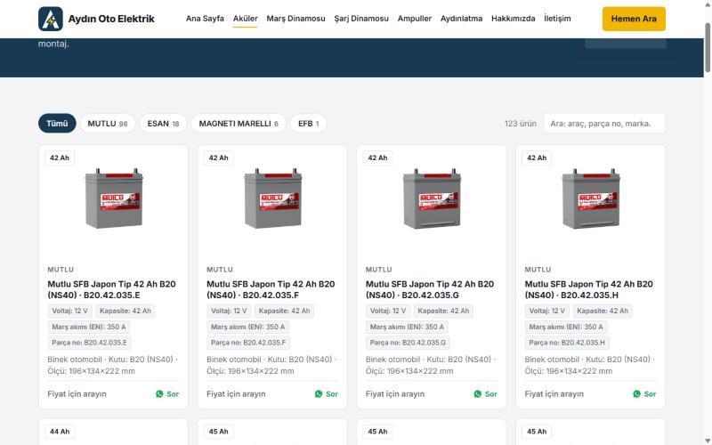
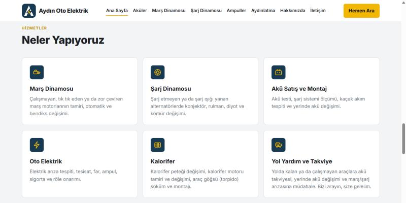
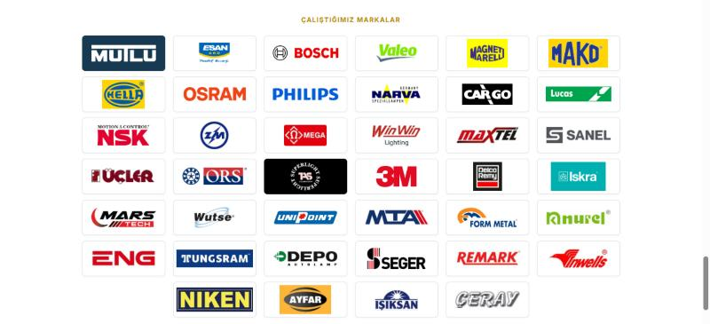

# Aydın Oto Elektrik — Web Sitesi

Ankara Etimesgut, Dökmeciler Sanayi Sitesi'ndeki **Aydın Oto Elektrik** için hazırlanmış ürün kataloğu ve tanıtım sitesi.

🔗 **Canlı site:** https://ahmetefekoc61-bit.github.io/aydin-oto-elektrik/

## Özellikler
- **~4.900 ürünlük katalog**: akü, marş ve şarj dinamosu (ve yedek parçaları), ampul, aydınlatma, elektrik malzemeleri, silecek
- Her kategoride **kategoriye özel teknik alanlar** (akü: Ah / CCA, marş: V / kW / diş sayısı, ampul: tip / V / W …) ve bunlara göre filtreleme
- Tüm ürünlerde **anlık arama** (araç adı, parça no, OEM no)
- 48'li sayfalama, mobil uyumlu tasarım, tek dokunuşla **Ara / WhatsApp / Yol Tarifi**
- Ürün başına WhatsApp'tan hazır mesajla soru sorma
- Hizmetler (dinamo tamiri, akü, oto elektrik, kalorifer, yol yardım ve takviye), sık sorulan sorular
- 40 markanın logosuyla "Çalıştığımız Markalar" bölümü
- Google Haritalar konumu, çalışma saatleri
- **Ürün yönetim paneli** (`yonetim.html`): kategori sekmeleri, satır içi düzenleme, taslak kaydı, `urunler.js` dışa aktarma

## Teknik
- Sunucu gerektirmeyen statik site (HTML + CSS + vanilla JavaScript), GitHub Pages üzerinde çalışır
- Veri tek bir JS dosyasında (`urunler.js`), kategori şeması `kategoriler.js` içinde tanımlı; yeni kategori eklemek için sadece şemaya kayıt eklemek yeterli
- Ortak bileşenler (menü, kartlar, filtre, arama) `ortak.js` içinde; her kategori sayfası birkaç satırlık bir şablon
- Ürün verisi toptancı listesinden ayıklanıp kelime kurallarıyla kategorilere ve teknik alanlara (V, Ah, kW, diş sayısı, ampul tipi…) ayrıştırılmıştır

## Dosyalar
| Dosya | Açıklama |
|---|---|
| `index.html` | Ana sayfa |
| `aku.html`, `mars-dinamosu.html`, `sarj-dinamosu.html`, `ampul.html`, `aydinlatma.html`, `elektrik.html`, `silecek.html`, `diger.html` | Kategori sayfaları |
| `yonetim.html` | Ürün yönetim paneli |
| `urunler.js` | Ürün verisi |
| `kategoriler.js` | Kategori tanımları |
| `ortak.js`, `ortak.css` | Ortak kod ve stil |
